# Atardecer de Sonora

[Español](#español) · [English](#english)

---

## Español

Un tema (mod) para Claude Code en la app de escritorio: un atardecer del desierto de Sonora detrás de la conversación, con nubes que se mueven despacio y un sol que baja con cada tarea que Claude termina.



### Cómo cambia con las tareas

| Situación | El cielo |
| --- | --- |
| No hay lista de tareas | Atardecer tranquilo: el sol sobre el horizonte y un degradado de dorado a naranja, rosa y morado |
| Empieza una lista | El sol está alto y el cielo, dorado |
| Cada tarea terminada | El sol baja y el cielo se vuelve más naranja, rosa y morado |
| Todas completas | Atardecer completo, con las primeras estrellas |

El mod sigue la lista de tareas de la sesión: `TodoWrite`, `TaskCreate` / `TaskUpdate` y la lista de tareas de la propia app de escritorio. Cada cambio se hace en unos 7 segundos, sin saltos.

| Inicio | Todo hecho |
| --- | --- |
|  |  |

También cuida la lectura: los paneles son semitransparentes y esmerilados, los mensajes llevan un fondo casi opaco y las nubes se quedan quietas si pides movimiento reducido.

### Instalación

En una sesión de terminal de Claude Code:

```text
/plugin install atardecer-de-sonora --marketplace lSoqui/atardecer-de-sonora
```

Desde un shell:

```text
claude plugin install atardecer-de-sonora --marketplace lSoqui/atardecer-de-sonora
```

En la app de escritorio, donde `/plugin` no corre: pulsa **+** junto a la caja del mensaje, luego **Plugins**, **Add marketplace** con `lSoqui/atardecer-de-sonora` y **Add plugin**.

### Uso

| Comando | Qué hace |
| --- | --- |
| `/atardecer` | Dice si el tema está encendido o apagado |
| `/atardecer off` | Apaga el tema en esta sesión y devuelve la app a su aspecto normal |
| `/atardecer on` | Lo vuelve a encender |

Para quitarlo del todo: `/plugin uninstall atardecer-de-sonora`.

### Qué hace y qué no

- **No añade texto a tus mensajes ni al prompt**, así que no gasta tokens. No hay ningún hook de `prompt.submit` ni de `prompt.compose`. La respuesta de `/atardecer` se marca «solo para ti» y no llega al modelo.
- Sin llamadas al modelo, sin red y sin escribir archivos propios. **No lee la conversación, archivos, variables de entorno, llaves, contraseñas ni credenciales**: solo ve la entrada y el resultado de las cuatro herramientas de tareas citadas abajo. Lo que recuerda lo guarda en memoria, durante la sesión.
- Agrega un solo comando, `/atardecer`. No agrega herramientas ni agentes.
- Corre únicamente:
  - al cargar la sesión (registra `/atardecer` y pone el tema);
  - después de una llamada a `TodoWrite`, `TaskCreate`, `TaskUpdate` o a la lista de tareas de la app (no toca la llamada ni su resultado);
  - al final de cada turno (da por hecha la última tarea del plan, como hace la app);
  - con `/clear` (el cielo vuelve a la calma);
  - al dibujar el fondo.

### Límites

- Solo se dibuja donde hay un cliente que dibuja temas, como la app de escritorio. La terminal y los editores no dibujan temas.
- Es un tema siempre oscuro: fuerza el modo oscuro de la app mientras está encendido.
- Usa la API de mods de Claude Code (hooks de funciones), que está en acceso anticipado y puede cambiar entre versiones. Probado con Claude Code 2.1.330.
- Si la lista de tareas la lleva otra herramienta que no sea una de las citadas, el mod no la ve y el cielo se queda en calma.
- Si el mod se carga con la sesión ya empezada, o reanudas una sesión, el cielo se queda en calma hasta que la lista de tareas cambie de nuevo.

### Desarrollo

```text
claude plugin validate --strict .
claude plugin test .
```

El cielo es una función pura, `hooks/scene.ts`, de «cuánto va el atardecer» y la hora a un SVG; la lectura de la lista está en `hooks/progress.ts` y todo se conecta en `hooks/register.tsx`. `hooks/make-colors.js` y `hooks/make-colors.d.ts` son una herramienta que Claude Code da para copiar en los mods; están sin modificar y no entran en la licencia. Las cadenas largas de dígitos hexadecimales de `make-colors.js` son las tablas de colores del sistema de diseño (cada 6 dígitos, un color); no son datos codificados.

### Licencia

MIT. Mira [LICENSE](LICENSE).

---

## English

A theme (mod) for Claude Code in the desktop app: a Sonoran desert sunset behind the conversation, with slow-moving clouds and a sun that sinks with every task Claude finishes.


### How it changes with your tasks

| Situation | The sky |
| --- | --- |
| No task list | A calm sunset: the sun above the horizon and a gradient from gold to orange, pink and purple |
| A list starts | The sun is high and the sky is golden |
| Each finished task | The sun sinks and the sky turns more orange, pink and purple |
| All tasks complete | The full sunset, with the first stars |

The mod follows the session's task list: `TodoWrite`, `TaskCreate` / `TaskUpdate`, and the desktop app's own task list. Each change takes about 7 seconds and never jumps.

| Start | All done |
| --- | --- |
|  |  |

It also looks after readability: panels are semi-transparent and frosted, messages sit on a nearly opaque background, and the clouds stand still if you ask for reduced motion.

### Install

In a Claude Code terminal session:

```text
/plugin install atardecer-de-sonora --marketplace lSoqui/atardecer-de-sonora
```

From a shell:

```text
claude plugin install atardecer-de-sonora --marketplace lSoqui/atardecer-de-sonora
```

In the desktop app, where `/plugin` does not run: click **+** next to the prompt box, then **Plugins**, **Add marketplace** with `lSoqui/atardecer-de-sonora`, then **Add plugin**.

### Usage

| Command | What it does |
| --- | --- |
| `/atardecer` | Tells you whether the theme is on or off |
| `/atardecer off` | Turns the theme off for this session and brings the app back to its own look |
| `/atardecer on` | Turns it back on |

To remove it completely: `/plugin uninstall atardecer-de-sonora`.

### What it does and does not do

- **It adds no text to your messages or to the prompt**, so it spends no tokens. There is no `prompt.submit` or `prompt.compose` hook. The reply to `/atardecer` is marked display-only and never reaches the model.
- No model calls, no network and no files of its own. **It does not read the conversation, files, environment variables, keys, passwords or credentials**: it only sees the input and result of the four task tools listed below. What it remembers lives in memory for the session.
- It adds a single command, `/atardecer`. It adds no tools or agents.
- It only runs:
  - when the session loads (registers `/atardecer` and sets the theme);
  - after a call to `TodoWrite`, `TaskCreate`, `TaskUpdate` or the app's task list (it leaves the call and its result alone);
  - at the end of each turn (it counts the plan's last task as done, as the app does);
  - on `/clear` (the sky goes back to calm);
  - when the backdrop is drawn.

### Limits

- It is only drawn where a client that draws themes is attached, such as the desktop app. The terminal and editors draw no themes.
- It is an always-dark theme: it forces the app's dark mode while it is on.
- It uses Claude Code's mod API (function hooks), which is early access and may change between releases. Tested with Claude Code 2.1.330.
- If the task list is kept by a tool other than those listed, the mod does not see it and the sky stays calm.
- If the mod loads after the session has already started, or you resume a session, the sky stays calm until the task list changes again.

### Development

```text
claude plugin validate --strict .
claude plugin test .
```

The sky is a pure function, `hooks/scene.ts`, from "how far along the sunset is" and the time to an SVG; reading the list lives in `hooks/progress.ts` and everything is wired together in `hooks/register.tsx`. `hooks/make-colors.js` and `hooks/make-colors.d.ts` are a helper that Claude Code provides to be copied into mods; they are unmodified and not covered by the license. The long runs of hexadecimal digits in `make-colors.js` are the design system's color tables (six digits per color), not encoded data.

### License

MIT. See [LICENSE](LICENSE).
